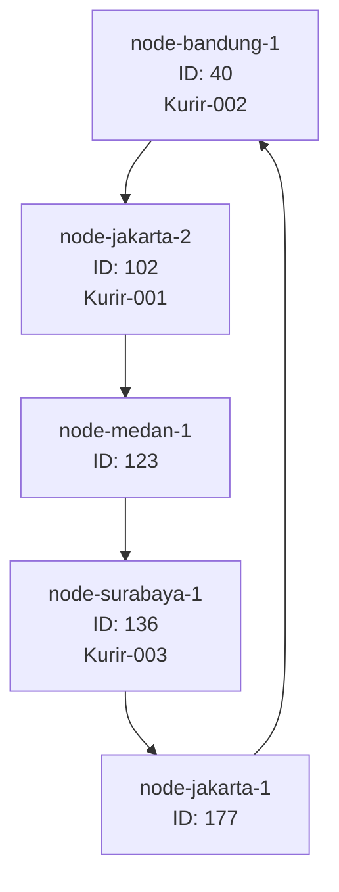
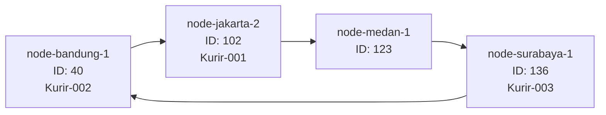

# Tugas 6 (Pekan 6) — Penamaan & Resolusi Lokasi

**Materi terkait:** Flat Naming, Structured Naming (DNS), Distributed Hash Table (DHT)/Chord.

## Studi Kasus

Pelanggan FoodGo kesulitan menemukan alamat IP server kurir yang **dinamis** (kurir berpindah lokasi/jaringan, IP-nya sering berubah). FoodGo butuh cara memetakan **ID Kurir** (identitas tetap) ke **alamat IP terkininya** tanpa server pusat tunggal yang jadi bottleneck/single point of failure.

## Tugas Kelompok

Implementasikan **simulasi Chord DHT** sederhana (single-process, tidak perlu jaringan sungguhan — cukup simulasi struktur data & algoritma di satu program Python) yang memetakan ID Kurir ke alamat IP mereka.

Konsep yang harus terlihat jalan dalam simulasi kalian:
1. **Consistent hashing**: ID Kurir dan ID Node di-hash ke ruang angka yang sama (mis. 0–255 untuk kesederhanaan, `m=8` bit).
2. **Ring topology**: node-node diurutkan melingkar berdasarkan hasil hash-nya.
3. **Lookup**: fungsi `lookup(kurir_id)` yang menemukan node mana yang bertanggung jawab menyimpan mapping ID Kurir tersebut → alamat IP-nya (aturan Chord: node dengan ID hash **terkecil yang lebih besar atau sama dengan** hash key, disebut *successor*).
4. **Perubahan topologi**: simulasikan minimal satu node baru bergabung (`join`) atau satu node keluar (`leave`), tunjukkan bagaimana mapping berpindah tanggung jawab ke node lain.

Skeleton disediakan di `src/chord_simulation.py` dengan fungsi hashing dan struktur ring sudah ada — bagian `lookup()`, `join()`, dan `leave()` sengaja dikosongkan.

### Cara Menjalankan

```bash
python3 src/chord_simulation.py
```

## Tugas Analisis (`README.md`)

1. Jelaskan **kenapa DHT/Chord** lebih cocok untuk kasus ini dibanding **flat naming sederhana** (mis. tabel pusat ID→IP) atau **DNS konvensional** — kaitkan dengan sifat "IP kurir sering berubah" dan kebutuhan tanpa titik gagal tunggal.

DHT dengan algoritma Chord cocok digunakan untuk mencari IP kurir karena alamat IP kurir bisa berubah sewaktu-waktu. Dengan Chord, pencarian data dilakukan berdasarkan ID yang sudah di-hash, kemudian sistem menentukan node yang bertanggung jawab atas data tersebut.
Jika dibandingkan dengan tabel pusat ID ke IP (flat naming sederhana), Chord memiliki kelebihan karena data dan tanggung jawab pencarian dibagi ke beberapa node. Jadi, sistem tidak hanya bergantung pada satu server pusat yang bisa menjadi titik kegagalan.
Sementara itu, DNS konvensional menggunakan sistem penamaan hierarkis dan dapat menyimpan hasil pencarian dalam cache. Untuk kasus IP kurir yang sering berubah, pembaruan data dan cache perlu dikelola agar informasi yang ditemukan tetap sesuai. Chord dapat menjadi alternatif karena pemetaan data dilakukan secara terdistribusi.
Namun, Chord tetap membutuhkan mekanisme tambahan, seperti replikasi data dan pemulihan node, agar sistem tetap berjalan ketika terjadi kegagalan. Pada tugas ini, Chord masih berupa simulasi dalam satu proses, sehingga belum sepenuhnya menunjukkan ketahanan jaringan terdistribusi.

2. Gambarkan (boleh pakai Mermaid, lihat Tugas 2) ring topology dari simulasi kalian, tandai node mana yang bertanggung jawab atas ID Kurir mana.

| ID Kurir | Hash | Node Penanggung Jawab |
| :--- | :---: | :--- |
| kurir-001 | 50 | node-jakarta-2 (102) |
| kurir-002 | 28 | node-bandung-1 (40) |
| kurir-003 | 132 | node-surabaya-1 (136) |



3. Jelaskan apa yang terjadi pada mapping saat sebuah node **keluar** dari ring (siapa yang mengambil alih tanggung jawabnya) — dukung dengan output program.

Ketika sebuah node keluar dari ring Chord, tanggung jawab atas data yang dikelolanya seharusnya dialihkan ke node successor berikutnya. Pada simulasi ini, `node-jakarta-1` dengan ID 177 keluar dari ring. Karena ID tersebut merupakan yang terbesar, successor berikutnya adalah `node-bandung-1` dengan ID 40 melalui mekanisme *wrap-around*.

Setelah node keluar, ring berubah dari lima node menjadi empat node. Hubungan successor diperbarui sehingga `node-surabaya-1` kembali terhubung ke `node-bandung-1`.

Ring Setelah Node Keluar

 Bukti Output Program
```text
--- Sebuah node keluar ---
Node 'node-jakarta-1' (id=177) keluar dari ring
```
Pada skenario ini, tidak ada data kurir yang perlu dialihkan dari `node-jakarta-1`, karena ketiga kurir yang didaftarkan tidak menjadi tanggung jawab node tersebut. Oleh karena itu, hasil lookup ketiga kurir tetap sama setelah node keluar.
Perlu diperhatikan bahwa program ini masih menyimulasikan perpindahan tanggung jawab. Data kurir disimpan dalam satu struktur `self.data`, sehingga belum benar-benar dipindahkan antar-node.

## Struktur Submission

```
tugas-06-penamaan-dht/
├── README.md      # Analisis + diagram ring
├── JURNAL.md
├── src/
│   └── chord_simulation.py
└── bukti/          # Output program (screenshot/log) untuk skenario join & leave
```

## Rubrik Penilaian (Tugas 6)

| Komponen | Bobot | Kriteria |
|---|---|---|
| Implementasi lookup/join/leave benar | 35% | Consistent hashing & successor lookup sesuai aturan Chord |
| Bukti perubahan topologi (join/leave) | 25% | Output menunjukkan mapping berpindah dengan benar |
| Analisis kenapa DHT vs flat naming/DNS | 25% | Argumen spesifik ke kasus IP kurir dinamis, bukan definisi umum |
| Proses & kontribusi kelompok | 15% | `JURNAL.md`, commit history |

## Batasan Penggunaan AI (Level 2)

Kebijakan **Level 2 (AI Assisted Idea Generation & Structuring)** berlaku — lihat [`../RUBRIK-UMUM.md`](../RUBRIK-UMUM.md). Boleh bertanya konsep umum consistent hashing/Chord ke AI; **tidak boleh** meminta AI menuliskan isi `# TODO` di `src/chord_simulation.py` (`find_successor`, `join`, `leave`, dst). Catat pemakaian AI di "Log Penggunaan AI" pada `JURNAL.md`.

- `README.md` wajib menelusuri manual (langkah demi langkah) bagaimana `lookup()` menemukan successor untuk salah satu ID Kurir contoh yang dipakai di `chord_simulation.py` — bukan cuma menempelkan output program.
