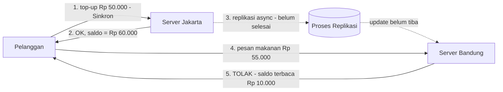
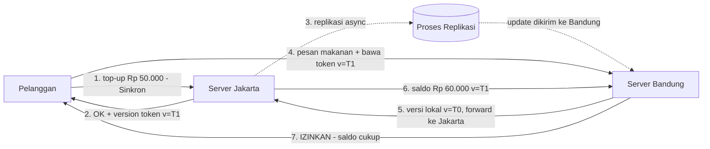

# Tugas 7 (Pekan 7) — Konsistensi Data

**Materi terkait:** Data-Centric Consistency (Sequential, Eventual), Client-Centric Consistency.

## Studi Kasus

Data saldo *e-wallet* pelanggan FoodGo berbeda antara server wilayah **Jakarta** dan **Bandung** karena replikasi antar server berjalan lambat. Contoh kasus nyata: pelanggan top-up saldo lewat server Jakarta, lalu dalam hitungan detik memesan makanan lewat aplikasi yang tersambung ke server Bandung — saldo belum ter-update, transaksi ditolak padahal saldo sebenarnya cukup.

## Tugas Kelompok

### Bagian 1 — Analisis (wajib)

1. Tentukan: apakah kasus ini **membutuhkan Sequential Consistency** (semua replika melihat urutan operasi yang sama) atau **cukup Eventual Consistency** (replika akan konsisten "pada akhirnya", boleh sementara berbeda)? Berikan argumen berbasis dampak bisnis (mis. kasus saldo *e-wallet* jauh lebih sensitif dibanding kasus "jumlah like" di media sosial).
2. Jika kalian menyimpulkan Eventual Consistency saja **tidak cukup** untuk skenario ini, usulkan pendekatan **Client-Centric Consistency** yang relevan (mis. *Read-Your-Writes*: pelanggan yang baru top-up harus selalu melihat saldo terbarunya sendiri, walau replika lain belum sinkron).
3. Gambarkan **diagram alir urutan (sequence diagram)** yang menunjukkan operasi read/write antara pelanggan, server Jakarta, server Bandung, dan proses replikasi — untuk skenario **tanpa** jaminan konsistensi (bug terjadi) DAN skenario **dengan** solusi yang kalian usulkan (bug teratasi). Pakai Mermaid (`sequenceDiagram`) di `README.md` — lihat contoh cara pakai di Tugas 2.

### Jawaban Bagian 1 — Analisis (wajib)
1. Untuk kasus saldo e-wallet di FoodGo, model yang dibutuhkan adalah Sequential Consistency, bukan hanya Eventual Consistency. Alasannya dari sisi dampak bisnis. Eventual Consistency memang efisien karena memperbolehkan replika antar server berbeda sementara, dengan asumsi "nanti juga akan sama". Pola ini sangat cocok untuk data yang tidak sensitif secara waktu, misalnya jumlah like di media sosial atau jumlah penonton sebuah video kalau angkanya terlambat satu dua detik pun tidak ada ruginya. Namun saldo e-wallet adalah data finansial yang langsung mempengaruhi keputusan transaksi. Dalam skenario FoodGo, pelanggan melakukan top-up Rp 50.000 melalui server Jakarta, lalu dalam hitungan detik memesan makanan melalui aplikasi yang terhubung ke server Bandung. Jika menggunakan Eventual Consistency, server Bandung belum menerima pembaruan saldo tersebut, sehingga pesanan akan ditolak meskipun saldo pelanggan sebenarnya sudah cukup. Ini bukan sekadar pengalaman pengguna yang buruk, tetapi ini berpotensi menyebabkan kerugian reputasi, pelanggan frustrasi, dan sengketa transaksi yang memerlukan intervensi manual CS. Oleh karena itu, semua replika wajib melihat urutan operasi yang sama sebelum transaksi diizinkan berjalan.
2. Karena Eventual Consistency saja tidak cukup untuk skenario ini, pendekatan yang paling tepat adalah menerapkan Client-Centric Consistency dengan pola Read-Your-Writes (RYW). Inti dari pendekatan ini sistem tidak perlu memaksa seluruh replika untuk sinkron secara bersamaan, karena itu sangat mahal dari sisi performa. Yang perlu dijamin hanyalah satu hal yaitu pelanggan yang baru saja melakukan perubahan data (misalnya top-up saldo) harus selalu bisa membaca hasil perubahannya sendiri, ke server mana pun ia terhubung setelahnya. Secara teknis, ini bisa diwujudkan dengan mekanisme version token atau timestamp per client. Cara kerjanya setiap kali top-up berhasil diproses oleh server Jakarta, sistem akan menerbitkan sebuah token versi (contohnya v=T1) yang kemudian disimpan di sesi atau cookie pelanggan tersebut. Nah, saat pelanggan membuka aplikasi dan permintaan baca saldonya diarahkan ke server Bandung, server Bandung tidak langsung merespons begitu saja. Ia terlebih dahulu mengecek apakah versi data lokalnya sudah mencapai atau melampaui token versi yang dibawa pelanggan. Jika ternyata belum, server Bandung punya dua pilihan yaitu menunda sebentar sambil menunggu data replikasi tiba, atau secara diam-diam meneruskan permintaan baca tersebut ke server Jakarta yang sudah memiliki data paling mutakhir. Hasilnya, pelanggan tidak akan pernah melihat saldonya seolah-olah "balik mundur" ke kondisi sebelum top-up dilakukan, tanpa harus mengorbankan performa keseluruhan sistem.
3. #### Skenario A — Tanpa Jaminan Konsistensi (bug terjadi)



#### Skenario B — Dengan Solusi Read-Your-Writes (bug teratasi)



### Bagian 2 — Simulasi (opsional, nilai tambah)

Skeleton `src/replica_simulation.py` mensimulasikan dua replika (Jakarta & Bandung) dengan delay replikasi buatan. Lengkapi TODO untuk:
1. Menunjukkan kondisi **inconsistent read** (replika Bandung masih menunjukkan saldo lama walau Jakarta sudah update).
2. Mengimplementasikan mekanisme **Read-Your-Writes** sederhana (mis. dengan version/timestamp per client) yang memperbaiki masalah tersebut.

```bash
python3 src/replica_simulation.py
```

## Struktur Submission

```
tugas-07-konsistensi-data/
├── README.md      # Analisis konsistensi + sequence diagram Mermaid
├── JURNAL.md
├── src/            # (opsional) simulasi replikasi
└── bukti/          # (jika mengerjakan simulasi) output program
```

## Rubrik Penilaian (Tugas 7)

| Komponen | Bobot | Kriteria |
|---|---|---|
| Ketepatan pemilihan model konsistensi | 30% | Argumen berbasis dampak bisnis nyata, bukan hafalan definisi |
| Kualitas sequence diagram | 30% | Menunjukkan jelas titik kegagalan & titik perbaikan |
| Usulan solusi client-centric | 25% | Solusi konkret dan dapat diimplementasikan (bukan wacana abstrak) |
| Proses & kontribusi kelompok | 15% | `JURNAL.md`, commit history (+ bonus jika simulasi dikerjakan) |

## Batasan Penggunaan AI (Level 2)

Kebijakan **Level 2 (AI Assisted Idea Generation & Structuring)** berlaku — lihat [`../RUBRIK-UMUM.md`](../RUBRIK-UMUM.md). Boleh bertanya konsep umum consistency model ke AI untuk brainstorming; **tidak boleh** meminta AI menuliskan analisis akhir/sequence diagram atau isi `# TODO` di `src/replica_simulation.py` yang tinggal ditempel. Catat pemakaian AI di "Log Penggunaan AI" pada `JURNAL.md`.

- Sebagai bukti pemahaman konsep (bukan hafalan jawaban skenario FoodGo saja), `README.md` wajib menyertakan **satu skenario tambahan** yang kalian buat sendiri (mis. kasus lain di aplikasi ojek online) dan menentukan model konsistensi yang tepat untuk skenario tambahan tersebut.
